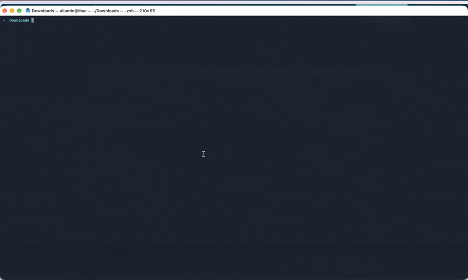

# Meeting Watcher

**Never forget to record a client call again.**

Meeting Watcher runs quietly on your Mac. The moment a **Zoom** or **Microsoft Teams** call starts, it opens [Meetily](https://meetily.ai) — a free, open-source meeting transcriber — and pops up a reminder. You click record only for the calls you want.

No subscription. No bot in your call. Nothing leaves your Mac.

- 💸 **Free** — no monthly fee, no account. Meeting Watcher and Meetily are both free and open source.
- 🔒 **Private** — transcribing happens on your Mac. No bot joins your calls, nothing is uploaded.
- 🎯 **Smart** — watches which app is using your microphone, so YouTube, podcasts and dictation never trigger it.
- 🙋 **You stay in control** — it reminds, it doesn't record by itself.

Made by [IhsanOps](https://ihsanops.ai) — *Less admin. More growth.*



---

## Install (about 10 minutes)

**You need:** a Mac (Apple Silicon or Intel) on macOS 14.2 or newer.

1. Open **Terminal** (press `⌘ Space`, type *Terminal*, press Enter).
2. Paste this and press Enter:

   ```bash
   curl -fsSL https://ihsanops.ai/meet.sh | bash
   ```

   If that link doesn't work, use: `curl -fsSL https://raw.githubusercontent.com/ali-tm-amin/meeting-watcher/main/install.sh | bash`

3. Open **Meetily** and allow **Microphone** and **Screen & System Audio Recording** in *System Settings → Privacy & Security*. Quit and reopen Meetily.
4. In Meetily, choose **Parakeet** as the transcription model.
5. Test it: join [zoom.us/test](https://zoom.us/test). Within ~20 seconds Meetily pops up with a notification.

That's it — it starts automatically every time you log in.

## Is this safe?

- **The installer is open source.** Read every line before you run it: [install.sh](install.sh).
- **It installs only to `~/meeting-watcher`** in your home folder, plus one launch-agent file in `~/Library/LaunchAgents` so it starts at login. Nothing goes into system folders.
- **It never asks for your password.** There is no `sudo` anywhere in it.
- **It never records or sends data anywhere.** It only asks macOS which app is using the microphone. Meetily does the transcribing, on your Mac.
- If Meetily isn't installed yet, the installer adds it with Homebrew or opens the official download page — your choice.

## How it works

Every 10 seconds, Meeting Watcher asks macOS which apps are using the microphone. If Zoom or Teams has it for ~20 seconds, a call has started: it opens Meetily and notifies you. When the call has been off the mic for ~1 minute, it reminds you to stop recording.

It never records audio itself and never sends anything anywhere.

## Your transcripts

Every recorded meeting appears in Meetily's sidebar. Copy the transcript into Claude, ChatGPT, Notion or your CRM.

> **Tip:** Let people know you're recording at the start of the call — it's good practice and helps with UK GDPR.

## Settings (optional)

Create `~/meeting-watcher/config` to change the defaults, for example:

```bash
INTERVAL=5          # check every 5 seconds
START_AFTER=3       # wait ~15s before treating it as a meeting
```

Then restart: `launchctl kickstart -k gui/$(id -u)/com.ihsanops.meeting-watcher`

## Troubleshooting

| Problem | Fix |
|---|---|
| No notification appears | System Settings → Notifications → **Script Editor** → allow |
| Meetily doesn't open | Check Meetily is in your Applications folder |
| Nothing happens in a call | Run `~/meeting-watcher/mic-users` during the call and send us the output |
| See what it detected | `cat ~/Library/Logs/meeting-watcher.log` |

## Uninstall

```bash
bash ~/meeting-watcher/uninstall.sh
```

Meetily and your transcripts are not touched.

---

## Want it done for you?

### £49 Quick Setup

- **30-minute remote session.** We install and test Meeting Watcher + Meetily on your Mac, set the permissions, run a test call, and show you where your transcripts are saved.
- **Bonus:** a quick look at where else admin is eating your time.

👉 [Pay £49 and pick your slot](https://buy.stripe.com/7sY3cx3CS8smg1abdL0RG0n) — you choose your 30-minute slot straight after paying.

### From £250 — Transcripts filed automatically

- **Everything in Quick Setup**, plus an automation that sends every meeting transcript into your CRM, Notion or Google Drive, filed under the right client.
- **Optional:** action items pulled out by AI after each call.

👉 [Talk to us](https://cal.com/ihsanopsai/15min)

---

MIT licence. Meetily is © Zackriya Solutions, MIT licence. Not affiliated with Meetily, Zoom or Microsoft.
